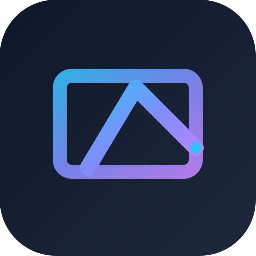
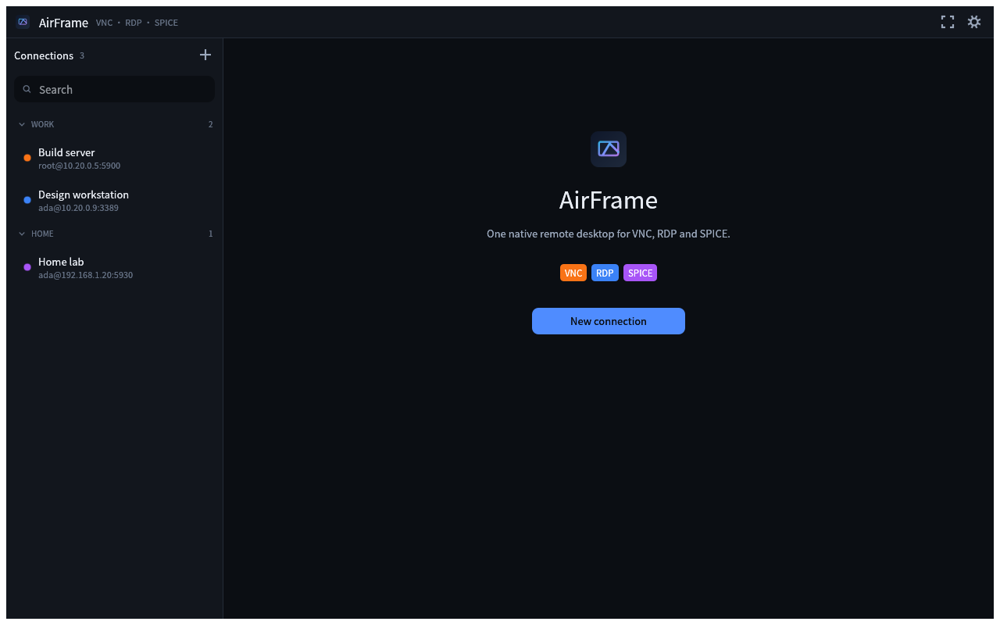

<div align="center">



# AirFrame

**One native remote desktop for VNC, RDP and SPICE.**

[](LICENSE)
[](https://www.rust-lang.org)
[]()
[](#building-from-source)

[English](#) · [简体中文](README.zh-CN.md)



</div>

---

## About

AirFrame is a native remote-desktop client written in Rust. It puts the three major protocols — VNC, RDP and SPICE — into one lightweight, GPU-accelerated interface, with unified handling of connections, input and clipboard, so you don't need a different client for every machine.

Prebuilt installers for macOS, Windows and Linux are published on [GitHub Releases](https://github.com/yybit/airframe/releases/latest). An experimental Android build is available from source — the layout is still desktop-oriented and it is not part of the release workflow yet.

## Features

- **Three protocols, one client** — VNC (RFB), RDP and SPICE; pick a protocol when creating a connection and the default port fills itself in
- **Native GPU-rendered UI** — built on egui/eframe; works out of the box on Linux (X11/Wayland), macOS and Windows, and has an experimental Android build
- **Connection management** — groups, search, tabs, `vnc://` / `rdp://` / `spice://` links for sharing and importing
- **Comfortable sessions** — overlay toolbar, fullscreen, three zoom modes (fit / 1:1 / stretch), view-only mode
- **Clipboard & text input** — clipboard text sync with the remote host, plus a send-text window that bypasses key mapping entirely
- **No global shortcuts** — every key goes to the session while one is focused, so `Ctrl+W`, `Ctrl+Q`, `F11` and Tab reach the remote untouched
- **Keyboard-layout independent** — keys are translated from their *physical* position (X11 keysyms for VNC, PC/XT scancodes for RDP/SPICE), so a Dvorak or AZERTY layout on your machine never leaks into the remote session
- **Dark & light themes + English / 中文** — the interface ships in English and Chinese
- **Passwords stay off disk by default** — passwords live in memory for the current run only, unless you explicitly tick "remember password"
- **Pure Rust** — `#![forbid(unsafe_code)]` across the workspace, with UI snapshot tests covering the main screens. (The only exception is the ~10-line Android entry point, which must export the `android_main` symbol.)

## Supported protocols

| Protocol | Default port | URL scheme | Backend |
|----------|-------------|-----------|---------|
| VNC (RFB) | 5900 | `vnc://` | [`vnc`](https://crates.io/crates/vnc) (Raw / CopyRect / Hextile / ZRLE decoding) |
| RDP | 3389 | `rdp://` | [IronRDP](https://crates.io/crates/ironrdp) (automatic security negotiation, compression, resolution follows the viewport) |
| SPICE | 5930 | `spice://` | [`spice-client`](https://crates.io/crates/spice-client) |

## Building from source

### Requirements

- Rust **1.95** or newer (`rustup update stable`)
- On Linux, the basic windowing/input system libraries (Ubuntu/Debian example):

  ```sh
  sudo apt install libxkbcommon-dev libxkbcommon-x11-dev libwayland-dev
  ```

  A GPU with Vulkan support is also required.
- On macOS, the Xcode command line tools are enough. On Windows, a Rust
  toolchain targeting MSVC is enough.

### Android (experimental)

The APK build additionally needs a JDK, the Android SDK **and** NDK, and
[`cargo-apk`](https://crates.io/crates/cargo-apk) to drive them:

```sh
# Rust build targets
rustup target add aarch64-linux-android armv7-linux-androideabi x86_64-linux-android

# cargo-apk drives the SDK/NDK
cargo install cargo-apk

# JDK — sdkmanager, keytool and apksigner are Java tools (Debian/Ubuntu example)
sudo apt install openjdk-17-jdk-headless
```

Then install the SDK components `cargo-apk` packages with (the platform must
match `target_sdk_version = 35` in `apps/airframe-android/Cargo.toml`):

```sh
export ANDROID_HOME="$HOME/Android/Sdk"
export ANDROID_NDK_ROOT="$ANDROID_HOME/ndk/<version>"    # e.g. ndk/30.0.16248370

sdkmanager --sdk_root="$ANDROID_HOME" --install \
    "build-tools;36.0.0" "platforms;android-35" "ndk;30.0.16248370"
```

Two things worth knowing:

- The RDP and SPICE backends compile C (rustls' crypto provider and LZ4), so
  the NDK toolchain — not just the Rust targets — is required. NDK r23+ has no
  plain `aarch64-linux-android-clang` wrapper, so point the `cc` crate at the
  API-level one (`min_sdk_version = 23`):

  ```sh
  TC="$ANDROID_NDK_ROOT/toolchains/llvm/prebuilt/linux-x86_64/bin"
  export CC_aarch64_linux_android="$TC/aarch64-linux-android23-clang"
  export CXX_aarch64_linux_android="$TC/aarch64-linux-android23-clang++"
  export AR_aarch64_linux_android="$TC/llvm-ar"
  ```

- Arch users: the AUR `android-platform` package installs its platform under a
  name like `platforms/android-37.0`, which `cargo-apk` cannot parse. Symlink
  the API level it expects (`ln -s android-37.0 …/platforms/android-35`) or
  raise `target_sdk_version` to match.

### Build & run

```sh
git clone https://github.com/yybit/airframe.git
cd airframe
cargo run --release      # build and launch
cargo test               # run tests (includes UI snapshot tests)
```

`make` wraps the common ones — run it on its own to list the targets:

```sh
make run                 # build and launch
make test                # the test suite
make lint                # clippy, exactly what CI lints
make mac                 # package the macOS app (see below)
```

Android (installing needs a device or emulator and `adb`):

```sh
cargo apk build -p airframe-android --lib             # debug APK
cargo apk build -p airframe-android --lib --release   # release APK
cargo apk run -p airframe-android --lib               # build, install and launch
```

The APK lands in `target/<profile>/apk/airframe.apk`. Debug builds are signed
with a debug key; release builds with `apps/airframe-android/release.keystore`
— a *public* key committed to the repo so upgrades keep installing without
anyone managing a secret. It proves the APK came from this repo; it is not a
store-distribution identity, so generate a private keystore if you ever ship
to an app store.

### macOS package

On a Mac with the Xcode command line tools:

```sh
make mac                 # .app and .zip for this machine's architecture
make mac-universal       # one bundle holding the Apple Silicon and Intel slices
```

`make mac` runs `packaging/macos/package.sh`, which builds `AirFrame.app`
(Info.plist, icon baked from `crates/ui/src/app_icon.rs`, ad-hoc signature) and
zips it to `dist/AirFrame-<version>-macos-<arch>.zip`. Both slices can also be
cross-built from Linux, given a macOS SDK:

```sh
SDKROOT=~/sdk/MacOSX15.5.sdk make mac-cross-x86_64
```

[`packaging/macos/README.md`](packaging/macos/README.md) covers what the cross
build needs and why. Either way the bundle is only signed ad-hoc, so Gatekeeper
quarantines a downloaded one: after unzipping, run
`xattr -dr com.apple.quarantine AirFrame.app` once before the first launch.

### Release packaging

Pushing a `v*` tag (or running the workflow manually from the Actions tab)
builds and publishes installers to [GitHub Releases](https://github.com/yybit/airframe/releases/latest):

- **macOS** — universal `.dmg` / `.zip` (Apple Silicon + Intel)
- **Windows** — x64 `.msi` installer / `.zip`
- **Linux** — x86_64 & aarch64 `.deb` / `.rpm` / `.AppImage` / `.tar.gz`

Android support is **experimental** (the layout is still desktop-oriented) and
is not part of the release workflow yet — build it from source with `cargo apk`
(above).

CI also runs clippy and the test suite on Linux and Windows for every push.
The packaging scripts work locally too: `make mac` (above),
`packaging/linux/package.sh --arch x86_64`, and
`packaging/windows/airframe.wxs` (WiX) for the Windows installer.

## Getting started

1. First launch shows an onboarding screen — click **New connection** to create one
2. Pick a protocol (VNC / RDP / SPICE), fill in the host and port (default pre-filled), username and password
3. Save, double-click the entry in the sidebar to connect; use the overlay toolbar for fullscreen and zoom while in a session

**Keyboard**

The app claims no global shortcuts: while a session is focused the keyboard
belongs to it, so `Ctrl+W`, `Ctrl+Q`, `F11` and Tab reach the remote untouched.
Everything the app itself does is on the overlay toolbar and the sidebar — new
connection, close, reconnect, send text, screenshot, fullscreen and zoom. Closing
the window quits.

## Where data lives

Saved connections and preferences are stored as plain JSON (passwords are written only when "remember password" is ticked):

- Linux / Unix: `~/.config/airframe/airframe.json` (respects `$XDG_CONFIG_HOME`)
- macOS: `~/Library/Application Support/AirFrame/airframe.json`
- Android (experimental): `/data/data/dev.airframe.app/files/airframe.json` — the app's private storage, removed when the app is uninstalled

## Project layout

```
apps/airframe        App: UI, session management, remote input (lib + desktop binary)
apps/airframe-android  Android entry point (`android_main`), packaged by cargo-apk
crates/core          Protocol-agnostic core: connection model, session contract, on-disk store
crates/vnc           VNC (RFB) backend
crates/rdp           RDP backend (IronRDP on a Tokio runtime)
crates/spice         SPICE backend
crates/ui            Theme, icons, shared widgets
packaging/macos      macOS packaging scripts (.app / universal binary)
packaging/linux      Linux packaging scripts (.deb / .rpm / .AppImage / .tar.gz)
packaging/windows    Windows installer definition (WiX .wxs)
```

Architecturally, the UI and the protocol backends don't depend on each other — they only communicate through the protocol-agnostic session contract in `airframe-core` (`SessionEvent` / `SessionCommand` channels). That is what keeps the three backends interchangeable and new protocols cheap to add.

## Status

v0.1.2, early days — interfaces and on-disk formats may still change.

## Contributing

Issues and pull requests are welcome. Please make sure `cargo test` passes and `cargo clippy` is warning-free before submitting.

## License

Licensed under **Apache-2.0** — see [LICENSE](LICENSE).

The bundled [Noto Sans SC](assets/fonts/OFL.txt) font is licensed under the SIL Open Font License.
