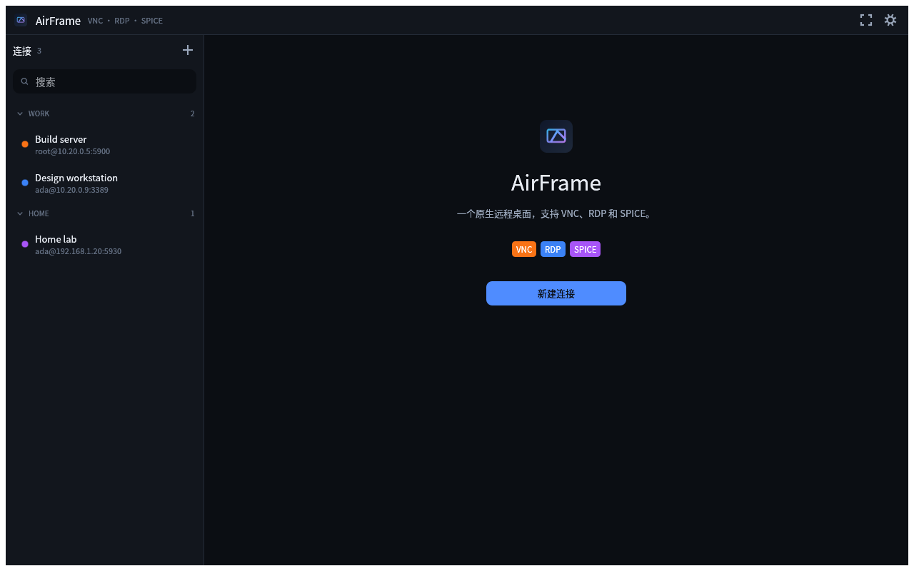

<div align="center">


# AirFrame

**一个原生远程桌面客户端，支持 VNC、RDP 和 SPICE。**

[](LICENSE)
[](https://www.rust-lang.org)
[]()
[](#从源码构建)

[简体中文](#) · [English](README.md)



</div>

---

## 简介

AirFrame 是一个用 Rust 编写的原生远程桌面客户端。它把三种主流协议——VNC、RDP 和 SPICE——装进同一个轻量、GPU 加速的界面里，用统一的方式管理连接、输入和剪贴板，无需为每台机器各装一个客户端。

macOS、Windows 和 Linux 的预构建安装包发布在 [GitHub Releases](https://github.com/yybit/airframe/releases/latest)。Android 为实验性支持，暂未进入发布流水线，请从源码构建（见下文）。

## 特性

- **三种协议，一个客户端** — VNC (RFB)、RDP、SPICE；新建连接时选协议，端口自动填好默认值
- **原生 GPU 界面** — 基于 egui/eframe，Linux (X11/Wayland)、macOS、Windows 和 Android 上开箱即用
- **连接管理** — 分组、搜索、标签页、`vnc://` / `rdp://` / `spice://` 链接导入分享
- **舒适的远程会话** — 悬浮工具栏、全屏、三种缩放（适应窗口 / 1:1 / 拉伸）、只读模式
- **剪贴板与文本输入** — 与远程主机同步剪贴板文本，另有绕过键盘映射直接输入文本的发送窗口
- **没有全局快捷键** — 会话获得焦点时键盘完全归它所有，`Ctrl+W`、`Ctrl+Q`、`F11`、Tab 都原样送给远程
- **键盘布局无关** — 按物理键位置转换按键（VNC 用 X11 keysym，RDP/SPICE 用 PC/XT scancode），本机的 Dvorak、AZERTY 等布局不会泄漏进远程会话
- **明暗主题 + 中英双语** — 界面内置中文与英文，主题支持深色 / 浅色
- **密码默认不落盘** — 密码只保存在内存中，除非显式勾选“记住密码”
- **纯粹 Rust** — 全工作区 `#![forbid(unsafe_code)]`，UI 快照测试覆盖主要界面（唯一例外是十几行的 Android 入口，它必须导出 `android_main` 符号）

## 支持的协议

| 协议 | 默认端口 | 链接协议 | 后端 |
|------|---------|---------|------|
| VNC (RFB) | 5900 | `vnc://` | [`vnc`](https://crates.io/crates/vnc)（Raw / CopyRect / Hextile / ZRLE 解码） |
| RDP | 3389 | `rdp://` | [IronRDP](https://crates.io/crates/ironrdp)（自动安全协商、压缩、分辨率跟随视口） |
| SPICE | 5930 | `spice://` | [`spice-client`](https://crates.io/crates/spice-client) |

## 从源码构建

### 环境要求

- Rust **1.95** 或更新版本（`rustup update stable`）
- Linux 需要基本的窗口/输入系统库（Ubuntu/Debian 示例）：

  ```sh
  sudo apt install libxkbcommon-dev libxkbcommon-x11-dev libwayland-dev
  ```

  另外需要支持 Vulkan 的显卡驱动。
- macOS 使用 Xcode 命令行工具即可；Windows 安装面向 MSVC 的 Rust 工具链即可。

### Android（实验性）

APK 构建额外需要 JDK、Android SDK **和** NDK，以及驱动它们的
[`cargo-apk`](https://crates.io/crates/cargo-apk)：

```sh
# Rust 构建目标
rustup target add aarch64-linux-android armv7-linux-androideabi x86_64-linux-android

# cargo-apk 负责调用 SDK/NDK
cargo install cargo-apk

# JDK —— sdkmanager、keytool、apksigner 都是 Java 工具（Debian/Ubuntu 示例）
sudo apt install openjdk-17-jdk-headless
```

然后安装打包所需的 SDK 组件（platform 版本必须和
`apps/airframe-android/Cargo.toml` 里的 `target_sdk_version = 35` 一致）：

```sh
export ANDROID_HOME="$HOME/Android/Sdk"
export ANDROID_NDK_ROOT="$ANDROID_HOME/ndk/<版本号>"    # 例如 ndk/30.0.16248370

sdkmanager --sdk_root="$ANDROID_HOME" --install \
    "build-tools;36.0.0" "platforms;android-35" "ndk;30.0.16248370"
```

两个容易踩的坑：

- RDP 和 SPICE 后端带有 C 代码（rustls 的加密库与 LZ4），因此必须安装 NDK
  工具链，仅装 Rust 的 Android target 是不够的。NDK r23 起没有
  `aarch64-linux-android-clang` 这个不带 API 级别的包装脚本，如果构建脚本报
  找不到它，指一下具体版本即可（与应用的 `min_sdk_version = 23` 保持一致）：

  ```sh
  TC="$ANDROID_NDK_ROOT/toolchains/llvm/prebuilt/linux-x86_64/bin"
  export CC_aarch64_linux_android="$TC/aarch64-linux-android23-clang"
  export CXX_aarch64_linux_android="$TC/aarch64-linux-android23-clang++"
  export AR_aarch64_linux_android="$TC/llvm-ar"
  ```

- Arch 用户：AUR 的 `android-platform` 包把平台目录装成
  `platforms/android-37.0` 这种带小数点的名字，`cargo-apk` 解析不了。做一个
  符号链接（`ln -s android-37.0 …/platforms/android-35`），或者把
  `target_sdk_version` 改成一样的值。

### 构建与运行

```sh
git clone https://github.com/yybit/airframe.git
cd airframe
cargo run --release      # 编译并启动
cargo test               # 运行测试（含 UI 快照测试）
```

`make` 封装了常用命令，直接运行 `make` 会列出全部目标：

```sh
make run                 # 编译并启动
make test                # 运行测试
make lint                # clippy，与 CI 完全一致
make mac                 # 打包 macOS 应用（见下文）
```

Android（安装需要已连接的设备或模拟器，以及 `adb`）：

```sh
cargo apk build -p airframe-android --lib             # debug APK
cargo apk build -p airframe-android --lib --release   # release APK
cargo apk run -p airframe-android --lib               # 编译、安装并启动
```

APK 产出在 `target/<profile>/apk/airframe.apk`。debug 构建用调试密钥签名；
release 构建用仓库里提交的 `apps/airframe-android/release.keystore` ——
这是一把**公开**的密钥，提交进仓库是为了升级安装不因签名变化而失败，也免去
管理机密的负担。它只证明"APK 来自本仓库"，不是应用商店的分发身份；若要上架
商店，请自行生成私有密钥库并不要提交。

### macOS 打包

在装有 Xcode 命令行工具的 Mac 上：

```sh
make mac                 # 生成当前架构的 .app 和 .zip
make mac-universal       # 生成同时包含 Apple Silicon 与 Intel 切片的包
```

`make mac` 调用 `packaging/macos/package.sh`：构建 `AirFrame.app`（Info.plist、
图标由 `crates/ui/src/app_icon.rs` 烘焙、ad-hoc 签名），并压缩为
`dist/AirFrame-<version>-macos-<arch>.zip`。两个架构也可以在 Linux 上交叉
构建，只要有一份 macOS SDK：

```sh
SDKROOT=~/sdk/MacOSX15.5.sdk make mac-cross-x86_64
```

交叉构建需要什么、为什么需要，见
[`packaging/macos/README.md`](packaging/macos/README.md)。无论哪种方式，产物
都只有 ad-hoc 签名，因此下载来的包会被 Gatekeeper 隔离：解压后首次启动前执行
一次 `xattr -dr com.apple.quarantine AirFrame.app`。

### 发布打包

推送 `v*` 标签（或在 Actions 页手动触发工作流）即可构建并发布安装包到
[GitHub Releases](https://github.com/yybit/airframe/releases/latest)：

- **macOS** — 通用 `.dmg` / `.zip`（Apple Silicon + Intel）
- **Windows** — x64 `.msi` 安装包 / `.zip`
- **Linux** — x86_64 与 aarch64 的 `.deb` / `.rpm` / `.AppImage` / `.tar.gz`

Android 支持目前是**实验性**的（页面布局仍按桌面设计），未进入发布流水线，
请用上文的 `cargo apk` 从源码构建。

CI 会在每次推送时于 Linux 和 Windows 上运行 clippy 与测试。
打包脚本也可以本地直接用：`make mac`（见上文）、
`packaging/linux/package.sh --arch x86_64`，Windows 安装包用
`packaging/windows/airframe.wxs`（WiX）构建。

## 使用入门

1. 启动后首次使用会有引导界面，点击 **New connection** 新建连接
2. 选择协议（VNC / RDP / SPICE），填写主机地址与端口（默认端口已自动填好）、用户名和密码
3. 保存后从侧边栏双击即可连接；会话中可用悬浮工具栏切换全屏与缩放

**键盘**

应用不占用任何全局快捷键：会话获得焦点后键盘完全归它所有，`Ctrl+W`、
`Ctrl+Q`、`F11`、Tab 都会原样送给远程。应用自身的操作都在悬浮工具栏和侧边栏上
—— 新建连接、关闭、重连、发送文本、截图、全屏与缩放。关闭窗口即退出。

## 数据存放位置

保存的连接与偏好设置以 JSON 明文存储（密码仅在勾选“记住密码”时写入）：

- Linux / Unix：`~/.config/airframe/airframe.json`（遵循 `$XDG_CONFIG_HOME`）
- macOS：`~/Library/Application Support/AirFrame/airframe.json`
- Android：`/data/data/dev.airframe.app/files/airframe.json` —— 应用私有目录，卸载应用即被清除

## 项目结构

```
apps/airframe        应用本体：界面、会话管理、输入与快捷键（库 + 桌面可执行）
apps/airframe-android  Android 入口（`android_main`），由 cargo-apk 打包
crates/core          协议无关核心：连接模型、会话契约、本地存储
crates/vnc           VNC (RFB) 后端
crates/rdp           RDP 后端（基于 IronRDP，Tokio 运行时）
crates/spice         SPICE 后端
crates/ui            主题、图标、通用控件
packaging/macos      macOS 打包脚本（.app / 通用二进制）
packaging/linux      Linux 打包脚本（.deb / .rpm / .AppImage / .tar.gz）
packaging/windows    Windows 安装包定义（WiX .wxs）
```

架构上，UI 与各协议后端互不依赖，只通过 `airframe-core` 的会话契约（`SessionEvent` / `SessionCommand` 通道）通信——这也是三种后端可以互相替换、新增协议成本很低的原因。

## 项目状态

v0.1.1，仍处于早期开发阶段，接口与配置格式都可能变化。

## 参与贡献

欢迎 Issue 和 Pull Request。提交前请确保 `cargo test` 通过、`cargo clippy` 无警告。

## 许可证

本项目采用 **Apache-2.0** 许可证（见 [LICENSE](LICENSE)）。

内置的 [Noto Sans SC](assets/fonts/OFL.txt) 字体遵循 SIL Open Font License。
